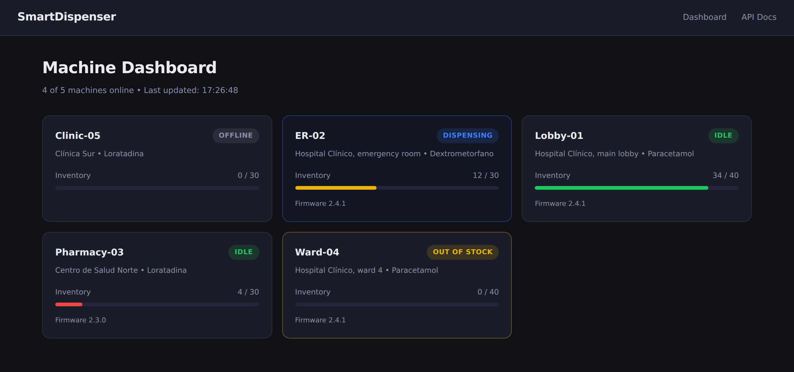
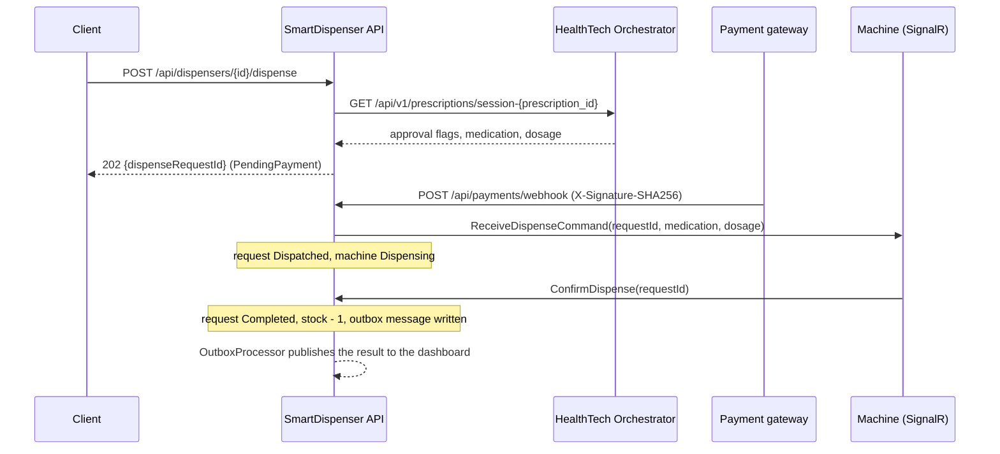

# SmartDispenser Core

[](https://github.com/kauan287/smartdispenser-core/actions/workflows/ci.yml)
[](https://dotnet.microsoft.com)
[](LICENSE)

SmartDispenser Core is an ASP.NET Core 10 backend for a network of pharmaceutical vending machines. Before a machine releases a medication, the backend checks the prescription with the [HealthTech Agent Orchestrator](https://github.com/kauan287/healthtech-agent-orchestrator) and waits for a signed payment webhook. Machines connect over SignalR, and a Blazor Server dashboard shows their state live.

**Live demo.** Dashboard at https://smartdispenser-core.onrender.com/dashboard and Swagger UI at https://smartdispenser-core.onrender.com/swagger. It runs on Render's free plan with the in-memory database, so the first request after 15 idle minutes takes about a minute, and the data resets on every restart. The Blueprint lives in [healthtech-agent-orchestrator](https://github.com/kauan287/healthtech-agent-orchestrator#deploy-both-services-to-render).



## What this project shows

- Two state machines with explicit transition tables (`DispenseRequest.cs`, `Dispenser.cs`). A request cannot be dispatched before it is paid, paid twice, or failed after it completed.
- One `SaveChangesAsync` per command and a transactional outbox (`AppDbContext.cs`, `OutboxProcessor.cs`). The payment, the request, the machine, and the outbox message commit together or not at all.
- Races that tests force on purpose. Two webhooks for one machine, two reservations of one prescription, and a heartbeat during a payment each have a test, and the database-level ones run on PostgreSQL in CI.
- An HMAC-SHA256 webhook check that reads the signature header before the body, compares in constant time, and caps chunked bodies at 512 KB (`WebhookSignatureMiddleware.cs`).
- A machine protocol over SignalR that integration tests drive with a real client (`DispenserHub.cs`, `DispenseFlowTests.cs`).
- A fail-closed contract with a Python service. A missing approval flag reads as `false`, and a tampered prescription reports the audit failure before any other rejection reason (`HealthTechApiClient.cs`, `Dtos.cs`).

## Part of a two-service system

| Service | Stack | Role |
|---|---|---|
| [HealthTech Agent Orchestrator](https://github.com/kauan287/healthtech-agent-orchestrator) | Python, FastAPI, LangGraph, PostgreSQL | AI triage, allergy checks, doctor sign-off, tamper-evident audit trail |
| SmartDispenser Core (this repository) | C#, ASP.NET Core 10, SignalR, Blazor Server, EF Core | Prescription gate, payment webhooks, machine control, dashboard |

A machine dispenses only when all of these hold:

1. The orchestrator knows the prescription.
2. The orchestrator's audit chain is intact (`audit_chain_valid`). This is checked first, so a tampered record reports the audit failure rather than a missing approval.
3. A doctor approved it and the session is not paused waiting for approval (`human_approved`, `is_paused_waiting_approval`).
4. The safety agent approved it (`safety_approved`).
5. It proposes a medication and a dosage, and the dosage is at most 100 characters.
6. The machine stocks that medication. The names are compared without regard to case.
7. The prescription has no other dispense request that is pending, dispatched, interrupted, or completed.
8. The machine is `Idle`, both when the request is reserved and when the payment arrives.
9. The payment gateway confirmed payment in a webhook whose HMAC-SHA256 signature is valid.

To run both services together and check the whole pipeline, from triage to a confirmed dispense, follow [Run both services together](https://github.com/kauan287/healthtech-agent-orchestrator#run-both-services-together) in the orchestrator's README.

## Quick start

### Run locally with the in-memory database

You need the [.NET 10 SDK](https://dotnet.microsoft.com/download/dotnet/10.0). No database or other service is required.

```bash
git clone https://github.com/kauan287/smartdispenser-core.git
cd smartdispenser-core
dotnet run --project src/SmartDispenser.API
```

The `http` profile in `launchSettings.json` runs in the `Development` environment, listens on http://localhost:5000 and uses the EF Core in-memory provider. Data is lost when the process stops.

- Swagger UI at http://localhost:5000/swagger
- Dashboard at http://localhost:5000/dashboard
- Liveness probe at http://localhost:5000/health/live

In a second terminal, run the smoke test. It registers a machine, checks the dashboard, and sends a forged and a signed webhook:

```bash
WEBHOOK_SECRET=local-development-secret-not-for-production scripts/smoke.sh http://localhost:5000
```

### Run with Docker Compose and PostgreSQL

```bash
cp .env.example .env    # then set WEBHOOK_SECRET to a random value of 32+ characters
docker compose up --build
```

The API listens on http://localhost:8001 and applies EF Core migrations at startup. PostgreSQL is published on `localhost:5433`. CI runs the same two commands, with `docker compose up -d`, and then `scripts/smoke.sh http://localhost:8001`.

To dispense, the orchestrator must be reachable at `HEALTHTECH_API_URL` (default `http://host.docker.internal:8000`, an orchestrator on the host). Without it, `POST /api/dispensers/{id}/dispense` answers `503`.

## Architecture

The solution has three projects plus two test projects. Dependencies point inward. `API` depends on `Infrastructure` and `Core`, `Infrastructure` depends on `Core`, and `Core` depends only on MediatR and logging abstractions.

```
src/
  SmartDispenser.Core/            Entities, commands and handlers, ports (interfaces)
    Entities/                     Dispenser and DispenseRequest state machines, Payment, OutboxMessage
    Commands/                     InitiateDispense, ProcessPaymentWebhook, UpdateMachineState
    Interfaces/                   Repositories, IUnitOfWork, IDispenserNotifier, IHealthTechApiClient
  SmartDispenser.Infrastructure/  EF Core (PostgreSQL or in-memory), migrations, repositories,
                                  HealthTechApiClient with a resilience pipeline
  SmartDispenser.API/             Controllers, SignalR hub, webhook signature middleware,
                                  background services, Blazor Server dashboard
tests/
  SmartDispenser.UnitTests/         Domain, handlers on real repositories, orchestrator contract
  SmartDispenser.IntegrationTests/  Full HTTP + SignalR flow on WebApplicationFactory
```

### Dispense flow



### State machines

`DispenseRequest` uses a transition table:

| From | To |
|---|---|
| `PendingPayment` | `Dispatched` (payment confirmed), `Failed` (payment failed, or the machine was not ready when the payment arrived) |
| `Dispatched` | `Completed`, `Failed` (the machine reported a failure), `Interrupted` (the machine went offline or missed the dispatch deadline) |
| `Interrupted` | `Completed`, `Failed` (the machine reported the outcome after it reconnected) |

`Completed` and `Failed` are final. A request cannot be dispatched before it is paid, paid twice, or failed after completion. `Interrupted` means the machine received the command but nobody knows whether it released the medication. An interrupted request keeps its prescription locked. Only `Failed` releases a prescription, and only a failed payment, a machine that was not ready for a paid request, or the machine's own failure report lead there.

`Dispenser` moves between `Offline`, `Idle`, `Dispensing`, `InventoryEmpty`, and `Error`. `Idle` always means stock is above zero. A restock moves an empty machine back to `Idle`, and dispensing the last unit moves it to `InventoryEmpty`. A machine can only confirm or fail its own requests. If it goes offline mid-dispense, the request becomes `Interrupted`. If it does not confirm within the dispatch deadline, the request becomes `Interrupted` and the machine moves to `Error`.

### Consistency

- **One transaction per command.** Repositories only load and track entities. Each handler calls `IUnitOfWork.SaveChangesAsync` once, so the payment, the request, the dispenser, and the outbox message commit together or not at all.
- **One live request per prescription.** The handler checks first, and a unique index on `DispenseRequests.PrescriptionId`, filtered to rows whose status is not `Failed`, rejects a concurrent second reservation. The loser gets the same `422` as the check.
- **Idempotent webhooks.** The service stores a payment only for a confirmation or a known failure of a request that awaits payment. A repeated idempotency key of such an event answers `{"received":true,"duplicate":true}` and changes nothing. The service does not record any other event, so a replay is processed again and changes nothing again. Unique indexes on `Payments.IdempotencyKey` and `Payments.ExternalTransactionId` reject a concurrent duplicate.
- **Optimistic concurrency.** `Dispenser.Version` is a concurrency token that every state or stock change increments. A heartbeat from a machine that is already online only records the time, so it never makes another command lose. If two commands race for one machine, the second save fails and rolls back, so a machine never receives two dispense commands. A webhook that loses such a race, or hits a unique index, answers `409`, and the gateway must retry the same payload.
- **Transactional outbox.** When a dispense request reaches `Completed` or `Failed`, `AppDbContext.SaveChangesAsync` adds an `OutboxMessage` in the same transaction. `OutboxProcessor` polls every 2 seconds and publishes due messages to the dashboard. A failed delivery is retried after 5, 25, 125, and 625 seconds and is marked `DeadLetter` after the fifth failure.

### Resilience and security

- `HealthTechApiClient` uses `AddStandardResilienceHandler`: 3 retries with exponential backoff from 2 seconds, a 10-second timeout per attempt, a 30-second total timeout, and a circuit breaker that opens for 60 seconds when at least half of 5 or more calls in 30 seconds fail. A 404 means the prescription is unknown, and the API rejects it with `422`. An outage answers `503`.
- `WebhookSignatureMiddleware` rejects a request without `X-Signature-SHA256` with `401` before it reads the body. It then computes HMAC-SHA256 over the raw request body and compares it with `sha256=<lowercase hex>` using `CryptographicOperations.FixedTimeEquals`. A wrong signature answers `401`. A body over 512 KB answers `413`, with or without a `Content-Length`. The app refuses to start when `Webhook:Secret` is shorter than 32 characters.
- The webhook endpoint has a sliding-window rate limit of 10 requests per second, with a queue of 5. The limit is global, not per client. Excess requests get `429`.
- `RateLimit:PermitsPerMinute` turns on a per-client limit for every request outside `/health`, in fixed windows of one minute with no queue. The default `0` turns it off. A negative value stops the app at startup. The client is the remote IP address, or the value of the header named in `RateLimit:ClientIpHeader` when that is set, for example `CF-Connecting-IP` behind Cloudflare. Excess requests get `429` with a `Retry-After` header in seconds.
- `HeartbeatMonitor` checks every 30 seconds. It marks a machine `Offline` after 90 seconds without a heartbeat. It moves a request that is still `Dispatched` after `Dispense:DispatchDeadline` (default `00:02:00`) to `Interrupted`, and its machine to `Error`.
- `/health/live` runs no checks and reports whether the process is up. `/health/ready` checks the database connection.
- Serilog writes structured logs to the console, including one line per HTTP request.

## API

Swagger UI at `/swagger` documents every endpoint. The OpenAPI document is at `/openapi/v1.json`.

| Method and path | Purpose | Responses |
|---|---|---|
| `GET /api/dispensers` | List machines and their state | 200 |
| `GET /api/dispensers/{id}` | Get one machine | 200, 404 |
| `POST /api/dispensers` | Register a machine and the one medication it stocks (starts `Offline`) | 201, 400 |
| `POST /api/dispensers/{id}/dispense` | Verify a prescription and reserve a dispense request | 202, 400, 404 (machine), 422 (rejected, including a medication the machine does not stock), 503 (orchestrator down) |
| `GET /api/dispense-requests/{id}` | Get a dispense request's status | 200, 404 |
| `POST /api/payments/webhook` | Payment gateway callback, signed | 200, 400 (malformed, or a field longer than its column), 401, 409 (retry), 413, 429 |

A rejected dispense returns RFC 7807 problem details:

```json
{
  "title": "Dispense request rejected",
  "status": 422,
  "detail": "Audit chain integrity check failed: possible data tampering."
}
```

Payment webhook body:

```json
{
  "transactionId": "TX-001",
  "idempotencyKey": "idem-abc123",
  "dispenseRequestId": "3fa85f64-5717-4562-b3fc-2c963f66afa6",
  "amount": 15.50,
  "currency": "EUR",
  "status": "confirmed",
  "provider": "sandbox",
  "timestamp": "2026-01-01T12:00:00Z"
}
```

Sign it with the shared secret:

```bash
SIG=$(printf '%s' "$BODY" | openssl dgst -sha256 -hmac "$WEBHOOK_SECRET" -hex | awk '{print $NF}')
curl -X POST http://localhost:5000/api/payments/webhook \
  -H "Content-Type: application/json" -H "X-Signature-SHA256: sha256=$SIG" -d "$BODY"
```

The webhook reads `status` without regard to case:

| `status` | Effect |
|---|---|
| `confirmed` | Records the payment and dispatches the request to the machine. |
| `failed`, `declined`, `cancelled`, `expired` | Records the payment and fails the request, which releases the prescription. |
| Any other value, such as `pending` or `authorized` | Records nothing. The request stays `PendingPayment`. |

The webhook answers `200` for every signed request it processes, including one it cannot apply, such as an unknown request id. A gateway therefore does not retry a payload that can never succeed. The reason goes to the log. The webhook answers `409` when a concurrent command changed the same data first. It saved nothing, so the gateway must retry the same payload.

### Machine protocol (SignalR)

A machine connects to `/hubs/dispensers?machineId={dispenser-id}&firmwareVersion={version}`. The hub drops a connection whose `machineId` is not a registered dispenser. Each call a machine makes applies to that machine. A machine in `Error` returns to service when it disconnects and reconnects, which a technician does after clearing the fault.

A machine must call `SendHeartbeat` more often than every 90 seconds. Otherwise `HeartbeatMonitor` marks it `Offline` and interrupts its dispense, even while its SignalR connection is open. A call fails with a `HubException` when another command changed the same machine first. Nothing was saved, so the machine retries the call, for example `ConfirmDispense`.

| Direction | Method | Effect |
|---|---|---|
| Machine to server | `SendHeartbeat()` | Records liveness. An `Offline` machine comes back online. |
| Machine to server | `ReportInventory(int count)` | Sets the stock level. |
| Machine to server | `ConfirmDispense(Guid requestId)` | Completes the request and decrements stock. For an `Interrupted` request, this also works after a reconnect. |
| Machine to server | `ReportDispenseFailure(Guid requestId, string error)` | Fails the request and moves the machine to `Error`. For an `Interrupted` request, it fails the request and leaves the machine's state alone. |
| Server to machine | `ReceiveDispenseCommand({requestId, prescriptionId, medication, dosage})` | Dispense one unit. |

`DispenseFlowTests` in the integration tests drives this protocol end to end with a real SignalR client.

### Orchestrator contract

`HealthTechApiClient` calls `GET /api/v1/prescriptions/session-{prescription_id}` and reads these fields. It ignores fields it does not know.

```json
{
  "thread_id": "session-RX-2024-001",
  "prescription_id": "RX-2024-001",
  "proposed_medication": "Ibuprofen",
  "dosage": "400 mg every 8 hours",
  "safety_approved": true,
  "risk_notes": null,
  "human_approved": true,
  "doctor_comments": "OK to dispense",
  "is_paused_waiting_approval": false,
  "audit_chain_valid": true
}
```

`HealthTechApiContractTests` deserializes this shape from literal samples, including the orchestrator's tampered response (`audit_chain_valid: false`, clinical fields `null`, `"status": "INVALID"`). The client ignores `status` and other fields it does not read. A missing boolean reads as `false`, so a dropped approval field rejects the dispense rather than allowing it.

## Testing

```bash
dotnet test SmartDispenser.sln
```

- **Unit tests** cover the state machines, the outbox backoff, the HMAC middleware against a signature computed with `openssl`, and the three handlers. The handlers run on the real repositories over the in-memory provider. Separate tests cover a partial-save failure and a concurrent write to one machine.
- **Integration tests** host the API with `WebApplicationFactory`, connect a SignalR client as the machine, and stub the orchestrator's HTTP responses. They cover the full flow from reservation through payment and confirmation to the dashboard, plus replayed webhooks, unsigned webhooks, prescription reuse, unknown prescriptions, interrupted dispenses, the dispatch deadline, and the rate limit. The webhook size tests run on Kestrel, because the in-memory test server buffers the request body. The tests that need a unique index or a transaction run only on PostgreSQL.

To run the integration tests on PostgreSQL, start the Compose database and run `make test-postgres`. CI runs them on InMemory and on a PostgreSQL 16 service container.

## Design decisions

**Reserve first, dispatch on payment.** Verifying the prescription before payment lets the client show a rejection before the patient pays. The hardware command waits for the webhook, so an unpaid request never reaches a machine.

**MediatR for commands, repositories for reads.** The three operations with business rules are MediatR handlers in `Core`, testable without ASP.NET. Reads and machine registration hold no rules, so their controllers call the repositories directly. `OutboxProcessor` also queries `AppDbContext` directly. MediatR stays on 12.x because later versions moved to a commercial license.

**The dashboard runs in process.** Blazor Server already holds a SignalR circuit to the browser, so the dashboard subscribes to `DispenserNotifier` events inside the process. An earlier version opened a second SignalR client from the server back to its own public URL, which failed behind Docker port mapping. The trade-off is that dashboard events stay in one process. Several API instances would need a SignalR backplane and a shared event bus.

**Machine identity comes from the query string.** This keeps the demo free of device certificates. Any client that knows a dispenser id can act as that machine. For production, `DispenserHub.OnConnectedAsync` should take the id from an authenticated claim, such as a device JWT `sub`.

## Known limitations

- A paid request that cannot be dispatched, for example because the machine went offline, is marked `Failed` with "Refund required". The service does not issue refunds.
- An `Interrupted` request keeps its prescription locked until its machine reports the outcome. No endpoint lets an operator resolve it by hand.
- `OnDisconnectedAsync` does not check that the closing connection is the machine's current one. After a machine reconnects, its old connection can time out and mark the live machine `Offline` until its next heartbeat. A request in flight then becomes `Interrupted`, which keeps its prescription locked.
- The in-memory provider has no transactions and no unique indexes. A save that fails partway can leave some rows behind, and two concurrent reservations of one prescription can both succeed. Use PostgreSQL for anything beyond a demo.
- The webhook does not check the amount against a price list.
- The REST API has no authentication. Anyone who can reach it can register machines, reserve prescriptions, and read dispense requests. Swagger UI is served in every environment. A production deployment needs an identity provider in front of the API, and an API key or mutual TLS for the gateway on top of the HMAC signature.
- The outbox has one consumer today, the in-process dashboard. `DispenserNotifier.PublishDispenseResultAsync` raises an in-process event and returns a completed task, so delivery does not fail, and the retry, backoff, and dead-letter path guards nothing yet. That path pays off once a real external consumer is added, such as a completion webhook to the orchestrator or a message broker.

## License

MIT. See [LICENSE](LICENSE).
